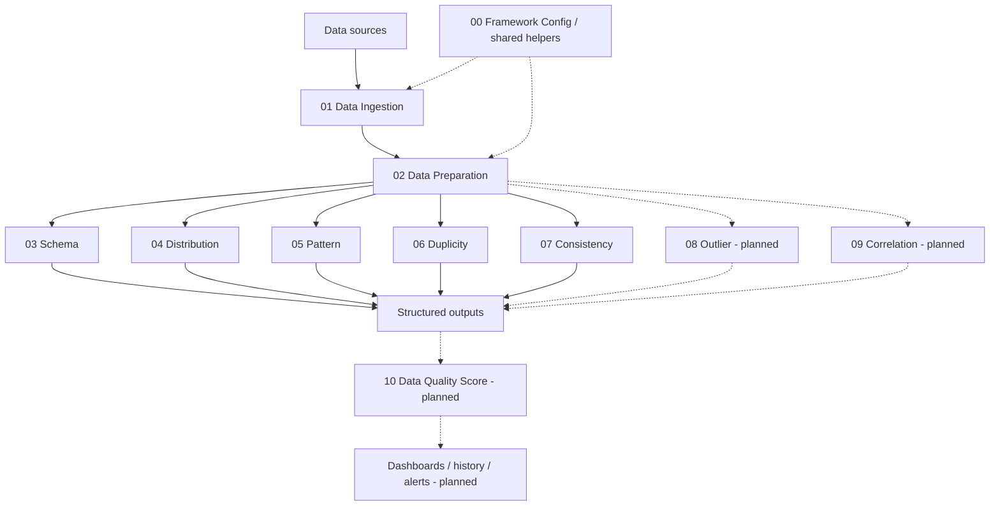

<div align="center">

# 🔎 Data Quality Framework

**Data quality engineering with PySpark and Databricks**  
*A modular framework that turns DataFrames into technical evidence about data quality.*

[🇧🇷 Português](README.md) · [🇺🇸 English](README.en.md)


[Overview](#-overview) · [Architecture](#-architecture) · [Profiles](#-modules-and-profiles) · [Getting started](#-getting-started) · [Roadmap](#-roadmap) · [Contributing](#-contributing)

</div>

---

## 🎯 Overview

**Data Quality Framework** is a data engineering project built with **Databricks, Apache Spark, and PySpark** to systematically inspect the schema, distributions, structural patterns, duplicates, and consistency of Spark DataFrames.

Its core principle is to **separate technical observations from business interpretation**: unusual values, repeated records, or unexpected relationships are **not automatically proof of invalid data**. Explicit domain rules can be introduced when appropriate.

The project aims to be **domain-agnostic, modular, reusable, metrics-driven, and suitable for distributed processing**. It is under active development: integrated automation, a consolidated quality score, and historical monitoring are planned capabilities, not completed features.

> **Design principle:** surface evidence about data quality without assuming column semantics or automatically penalizing legitimate statistical behavior.

## 🧭 Quick navigation

| I want to... | Go to |
|---|---|
| Understand the design | [Architecture](#-architecture) |
| Explore the metrics | [Modules and Profiles](#-modules-and-profiles) |
| Browse notebooks | [Repository structure](#-repository-structure) |
| Run a Profile | [Getting started](#-getting-started) |
| See upcoming work | [Roadmap](#-roadmap) |
| Contribute | [Contributing](#-contributing) |

## 🏗️ Architecture



**Layer responsibilities:**

- **Ingestion:** makes a source DataFrame available. The current example reads a CSV; general-purpose connectors are future work.
- **Preparation:** validates the input, inspects the schema, classifies data types, and exposes `df_prepared` plus shared metadata.
- **Framework Config:** centralizes imports and reusable helpers, reducing code duplication across Profiles.
- **Profiles:** produce dimension-specific metrics while distinguishing *exploratory signals*, *hypotheses*, and *explicit-rule violations*.
- **Consolidation and consumption:** planned layers for scoring, historical analysis, and visualization.

Profiles are **analytically independent of one another**, but share the preparation and configuration layers. In the current implementation, running a Profile loads upstream notebooks through `%run`.

## 📊 Modules and Profiles

| Module | Purpose | Project status |
|---|---|---|
| [01 · Data Ingestion](notebook/01_DATA_INGESTION.ipynb) | Load a source DataFrame | Implemented for the example source |
| [02 · Data Preparation](notebook/02_DATA_PREPARATION.ipynb) | Schema, types, eligibility, and input contract | Implemented |
| [03 · Schema Profile](notebook/03_SCHEMA_PROFILE.ipynb) | Completeness, nulls, blanks, cardinality, and types | Implemented |
| [04 · Distribution Profile](notebook/04_DISTRIBUTION_PROFILE.ipynb) | Frequencies, concentration, diversity, entropy, and statistics | Implemented; evolving |
| [05 · Pattern Profile](notebook/05_PATTERN_PROFILE.ipynb) | Length, character composition, patterns, and deviations | Implemented; evolving |
| [06 · Duplicity Profile](notebook/06_DUPLICITY_PROFILE.ipynb) | Full-row duplication, uniqueness, and candidate keys | Implemented; undergoing validation |
| [07 · Consistency Profile](notebook/07_CONSISTENCY_PROFILE.ipynb) | Intrinsic signals, candidate dependencies, and explicit temporal rules | Implemented; undergoing validation |
| 08 · Outlier Profile | IQR, Z-scores, and robust outlier detection | Planned |
| 09 · Correlation Profile | Associations between variables and potential redundancy | Planned |
| 10 · Data Quality Score | Explainable aggregation with applicability rules | Planned |

### What does each Profile answer?

<details>
<summary><strong>03 · Schema — Are data structurally complete?</strong></summary>

Examines types, null and blank values, completeness, distinct counts, and cardinality. Completeness describes data presence; its meaning depends on how attributes are used.

</details>

<details>
<summary><strong>04 · Distribution — How are values distributed?</strong></summary>

Computes frequencies, most common values, Top N concentration, Shannon entropy, and numeric statistics. Concentration or diversity alone do not indicate poor quality.

</details>

<details>
<summary><strong>05 · Pattern — Which structures occur in values?</strong></summary>

Examines lengths, character composition, and patterns such as `LLLNNN`, including prevalence and structural deviations. An uncommon pattern is an investigation signal, not proof of invalidity.

</details>

<details>
<summary><strong>06 · Duplicity — Are records repeated, and are there potential identifiers?</strong></summary>

Separates **rows belonging to duplicate groups** from **excess duplicate rows**, assesses attribute uniqueness, and explores single-column or composite candidate keys. Legitimate repetitions must not be automatically labeled errors.

</details>

<details>
<summary><strong>07 · Consistency — Are values and relationships coherent?</strong></summary>

Investigates blank strings, surrounding whitespace, special numeric values, candidate functional dependencies, and explicitly configured temporal rules. Distinguishes `SINAL_EXPLORATORIO` from `REGRA_EXPLICITA` in the current notebook outputs.

</details>

## 🗂️ Repository structure

```text
databricks-qualidade-de-dados/
├── README.md
├── README.en.md                  # English documentation (this bundle)
├── bibliotecas/
│   └── 00_FRAMEWORK_CONFIG.ipynb
└── notebook/
    ├── 01_DATA_INGESTION.ipynb
    ├── 02_DATA_PREPARATION.ipynb
    ├── 03_SCHEMA_PROFILE.ipynb
    ├── 04_DISTRIBUTION_PROFILE.ipynb
    ├── 05_PATTERN_PROFILE.ipynb
    ├── 06_DUPLICITY_PROFILE.ipynb
    └── 07_CONSISTENCY_PROFILE.ipynb
```

> This tree highlights the **main files covered by this documentation**, rather than every repository file. Modules 08–10, orchestration, and monitoring artifacts remain on the roadmap.

## ▶️ Getting started

**Requirements:** a Databricks environment supporting Python/PySpark notebooks, access to an input dataset, and read permissions. Development also considers **Databricks Free Edition**, within its resource limits.

1. Import or synchronize the repository into a Databricks **Git Folder**.
2. Open [`01_DATA_INGESTION.ipynb`](notebook/01_DATA_INGESTION.ipynb) and **update the input path** to a file accessible from your workspace. The current example uses a Brazilian electricity-distribution emergency-events CSV (ANEEL) with `;` as its separator.
3. Check shared imports and functions in [`bibliotecas/00_FRAMEWORK_CONFIG.ipynb`](bibliotecas/00_FRAMEWORK_CONFIG.ipynb). Newer Profiles may require additional shared helpers.
4. Run a Profile, such as `07_CONSISTENCY_PROFILE`, from its first cell. The current execution chain is:

   ```text
   07_CONSISTENCY_PROFILE
      └── %run 02_DATA_PREPARATION
             └── %run 01_DATA_INGESTION
                    └── %run 00_FRAMEWORK_CONFIG
   ```

5. Inspect the resulting DataFrames and validate the metrics against controlled samples before processing large datasets.

**Operational notes:** `%run` paths depend on folder layout; the ANEEL dataset is a **case study**, not a conceptual dependency of the Profiles. Other data sources currently require manual ingestion changes. Operations such as `countDistinct`, `groupBy`, and pairwise analysis can trigger Spark shuffles and require tuning.

### Example metrics

| Dimension | Example metrics | Interpretation |
|---|---|---|
| Schema | Completeness %, nulls, distinct counts | Presence and structure |
| Distribution | Top 1/3/5, entropy, mean, dispersion | Value behavior |
| Pattern | Dominant pattern, diversity, deviations | Structural regularity |
| Duplicity | Excess rows, duplicate groups, uniqueness | Repetition and potential identifiers |
| Consistency | Intrinsic signals, functional conflicts, explicit-rule violations | Coherence and evidence to investigate |

**Important:** these metrics **do not yet constitute a validated overall quality score**. A future score will require documented weights, applicability rules, denominators, and acceptance criteria.

## 🧪 Engineering principles

- **Domain independence:** analyses must not require prior knowledge of column names or business meaning.
- **Separation of concerns:** shared helpers live in the library; Profile-specific execution and metrics remain in each notebook.
- **Transparency:** document the analyzed population, applicability, and limitations of every metric.
- **Responsible interpretation:** an outlier, correlation, repetition, or rare pattern is not automatically a data error.
- **Scalability:** prefer distributed operations and avoid collecting full datasets to the driver.
- **Reproducibility:** document parameters, versions, and execution assumptions.

### Notebook documentation convention

Every analytical cell answers four questions:

```text
O QUE FAZ?             / WHAT DOES IT DO?
COMO FAZ?              / HOW DOES IT WORK?
POR QUE É IMPORTANTE?  / WHY DOES IT MATTER?
PERGUNTA RESPONDIDA?   / WHICH QUESTION DOES IT ANSWER?
```

This supports maintenance, technical review, auditing, and educational use.

## 🗺️ Roadmap

- [x] Modular architecture and shared preparation
- [x] Schema Profile
- [x] Distribution Profile — initial implementation
- [x] Pattern Profile — initial implementation
- [x] Duplicity Profile — initial implementation
- [x] Consistency Profile — initial implementation
- [ ] Mathematical and performance validation of existing Profiles
- [ ] Outlier Profile
- [ ] Correlation Profile
- [ ] Standardized output contracts and automated tests
- [ ] Explainable, configurable Data Quality Score
- [ ] Integrated orchestration and execution
- [ ] Historical persistence in Delta Lake
- [ ] Dashboards, alerts, and monitoring
- [ ] Parameterized ingestion for multiple sources

*An initial implementation marked complete does not imply production validation.*

## 🛠️ Technology stack

**Currently used:** Python, PySpark, Apache Spark, and Databricks.  
**Planned extensions:** Delta Lake, Databricks Workflows, and SQL queries/visualizations.

## 🤝 Contributing

Ideas, technical discussions, and contributions are welcome. Consider opening an [issue](https://github.com/laysabelici/databricks-qualidade-de-dados/issues) describing the problem or proposal before making significant architectural changes.

Please preserve domain independence, document the mathematical interpretation of metrics, keep shared utilities separate from Profiles, and include examples or tests where practical.

## 📜 License

The original README states an intention to use the **MIT License**. Before presenting this as the repository's effective license, confirm that a corresponding `LICENSE` file exists at the repository root.

---

<div align="center">

**Data Quality Framework · Evidence-driven data engineering**

[🇧🇷 Ler em português](README.md) · [Back to top](#-data-quality-framework)

</div>
