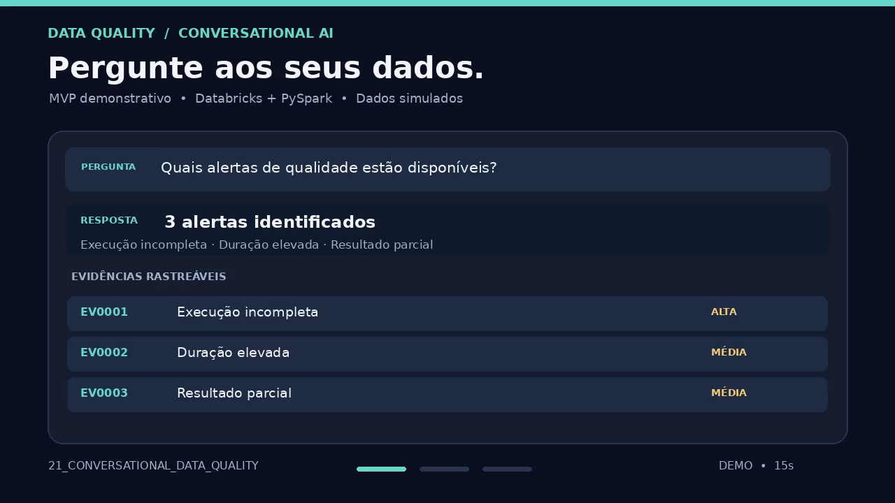
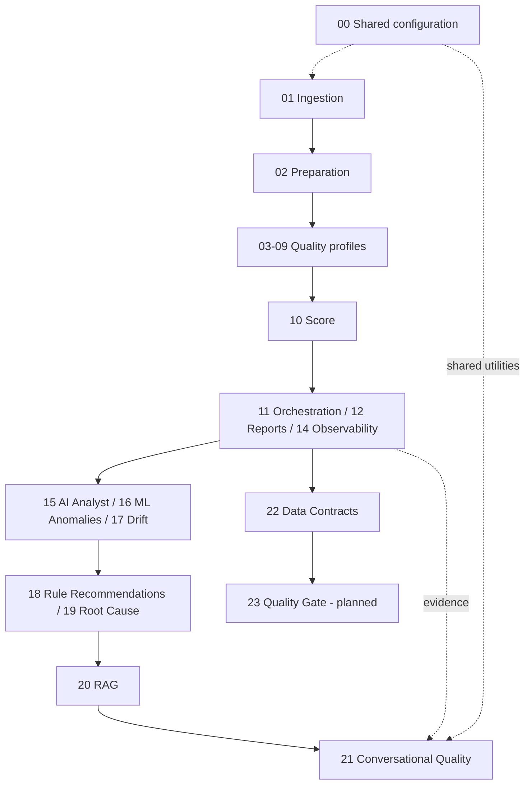

# Data Quality Framework | Data Engineering, ML & LLM

A modular, evidence-first data quality framework for Databricks and PySpark, spanning profiling, monitoring, machine learning, RAG, and optional LLM-assisted analysis.

[🇧🇷 Português](README.md) · [🇺🇸 English](README.en.md)

**Status:** notebooks developed incrementally; integrated execution and production readiness are not yet validated. Module 13 was deferred.

## Framework demo — 15-second MVP

**[▶ Watch the 15-second demonstration](video_mvp/mvp_data_quality_15s.mp4)**

The video illustrates a conversational data quality experience with questions, evidence-backed answers, and traceability. **Visual prototype using simulated data; not a recording of a live Databricks execution.**

## Design principles

- **Evidence before conclusions:** statistical anomalies do not necessarily imply data errors.
- **Domain-agnostic:** no hardcoded rules specific to ANEEL or any other dataset.
- **Explicit contracts:** acceptance criteria require human definition and approval.
- **Controlled LLM usage:** disabled by default, grounded in bounded evidence, with auditability and no automatic remediation.
- **Distributed processing:** use Spark DataFrame APIs compatible with Databricks Unity Catalog.

## Architecture

## Notebook catalog

| No. | Notebook | Purpose | Status |
|---|---|---|---|
| `00` | `FRAMEWORK_CONFIG` | Shared configuration and helpers | Under validation |
| `01` | `DATA_INGESTION` | Data ingestion | Under validation |
| `02` | `DATA_PREPARATION` | Data preparation | Under validation |
| `03` | `SCHEMA_PROFILE` | Schema and completeness | Under validation |
| `04` | `DISTRIBUTION_PROFILE` | Distributions and concentration | Under validation |
| `05` | `PATTERN_PROFILE` | Value patterns | Under validation |
| `06` | `DUPLICITY_PROFILE` | Duplicates and candidate keys | Under validation |
| `07` | `CONSISTENCY_PROFILE` | Consistency | Under validation |
| `08` | `OUTLIER_PROFILE` | Outlier analysis | Under validation |
| `09` | `CORRELATION_PROFILE` | Associations and correlations | Under validation |
| `10` | `DATA_QUALITY_SCORE` | Explainable quality score | Under validation |
| `11` | `FRAMEWORK_ORCHESTRATOR` | Orchestration | Under validation |
| `12` | `DATA_QUALITY_REPORT` | Reports and indicators | Under validation |
| `13` | `DATA_QUALITY_HISTORY` | History (deferred) | Deferred |
| `14` | `DATA_QUALITY_OBSERVABILITY` | Observability | Under validation |
| `15` | `AI_DATA_QUALITY_ANALYST` | AI-assisted analysis | Under validation |
| `16` | `ML_ANOMALY_DETECTION` | ML anomaly detection | Under validation |
| `17` | `DATA_QUALITY_DRIFT_DETECTION` | Drift detection | Under validation |
| `18` | `AI_RULE_RECOMMENDATION` | AI rule recommendations | Under validation |
| `19` | `AI_ROOT_CAUSE_ANALYSIS` | Root-cause hypotheses | Under validation |
| `20` | `DATA_QUALITY_RAG` | Knowledge retrieval (RAG) | Under validation |
| `21` | `CONVERSATIONAL_DATA_QUALITY` | Evidence-backed conversational queries | Under validation |
| `22` | `DATA_QUALITY_CONTRACTS` | Contracts and rule validation | Under validation |

## The role of the LLM

The LLM is an **optional reasoning and natural-language interface**, not a substitute for deterministic quality measurements. Modules 15, 18, 19, 20, and 21 explore assisted interpretation, rule proposals, root-cause hypotheses, retrieval, and conversational answers. Outputs must be checked against available evidence; suggestions and hypotheses are **not automatically approved facts**.

Module **21** reads bounded outputs from reports, observability, AI diagnostics, root-cause analysis, and RAG. It exposes `dq_chat_sources_df`, `dq_chat_evidence_df`, `dq_chat_responses_df`, and `dq_chat_audit_df`. The LLM integration is disabled by default.

## Getting started

1. Import the notebooks into a Databricks workspace.
2. Place the consolidated `00_FRAMEWORK_CONFIG` notebook in the shared `bibliotecas` folder, matching the `%run` paths in dependent notebooks.
3. Configure the data source in module 01, then run preparation (02).
4. Execute relevant profiles (03–09), then reporting and analytical modules as needed.
5. Enable optional LLM functionality **only after** configuring an authorized HTTPS endpoint and secrets. Never commit credentials.

> The exact folder structure and `%run` paths must be checked against your workspace. Notebooks have been syntax-checked in parts, but this is not a claim of end-to-end Databricks validation.

## Demonstration dataset

The project has used a public ANEEL emergency occurrences dataset for exploratory development. This is an **example**, not a domain-specific dependency. Any data use must respect the original source's license and privacy requirements.

## Roadmap

- [ ] Run end-to-end integration tests in Databricks Free Edition.
- [ ] Verify contracts between notebook outputs and consumers.
- [ ] Implement module 23: Data Quality Gate.
- [ ] Add lineage, evaluation of AI outputs, and dashboard interfaces.
- [ ] Define reproducible tests and CI checks.

## Responsible use

No universal quality acceptance percentage is assumed. Thresholds, policies, and contract approval belong to data owners. Automated remediation, persistent storage, and external LLM calls must be explicitly enabled and governed.

## Contributing

Issues and pull requests are welcome. Please include reproducible examples, expected behavior, and notes about Databricks runtime compatibility.
