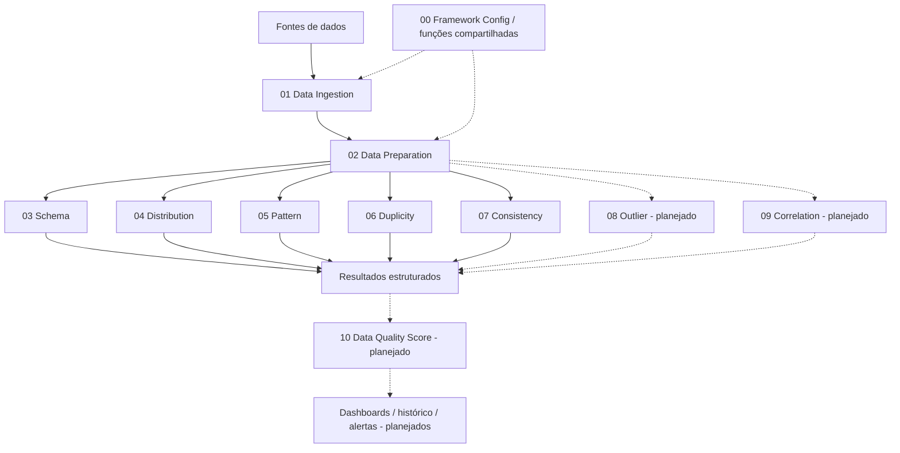

<div align="center">

# 🔎 Data Quality Framework

**Engenharia de qualidade de dados com PySpark e Databricks**  
*Um framework modular para transformar DataFrames em evidências técnicas sobre a qualidade dos dados.*

[🇧🇷 Português](README.md) · [🇺🇸 English](README.en.md)


[Visão geral](#-visão-geral) · [Arquitetura](#-arquitetura) · [Profiles](#-módulos-e-profiles) · [Execução](#-como-executar) · [Roadmap](#-roadmap) · [Contribuição](#-contribuição)

</div>

---

## 🎯 Visão geral

O **Data Quality Framework** é um projeto de engenharia de dados desenvolvido com **Databricks, Apache Spark e PySpark** para analisar sistematicamente a estrutura, distribuição, padrões, duplicidade e consistência de DataFrames.

Seu princípio central é **separar observação técnica de interpretação de negócio**: o framework pode encontrar um valor incomum, uma repetição ou uma relação inesperada, mas isso **não comprova, por si só, um erro**. Regras específicas podem ser acrescentadas explicitamente quando necessárias.

O projeto busca ser **genérico, modular, reutilizável, orientado a métricas e preparado para processamento distribuído**. Está em desenvolvimento; a automação completa, o score consolidado e o monitoramento histórico fazem parte da evolução planejada.

> **Princípio de projeto:** identificar evidências de qualidade sem presumir o significado de cada coluna ou penalizar automaticamente comportamentos estatísticos legítimos.

## 🧭 Navegação rápida

| Quero... | Acessar |
|---|---|
| Entender o desenho técnico | [Arquitetura](#-arquitetura) |
| Conhecer as métricas de cada módulo | [Módulos e Profiles](#-módulos-e-profiles) |
| Explorar os notebooks | [Estrutura do repositório](#-estrutura-do-repositório) |
| Executar um Profile | [Como executar](#-como-executar) |
| Ver o que vem depois | [Roadmap](#-roadmap) |
| Contribuir | [Contribuição](#-contribuição) |

## 🏗️ Arquitetura



**Responsabilidades das camadas:**

- **Ingestion:** disponibiliza o DataFrame de origem. A implementação de exemplo utiliza um CSV; conectores genéricos para outras fontes são uma evolução prevista.
- **Preparation:** valida a entrada, identifica o schema, classifica tipos e disponibiliza `df_prepared` e metadados compartilhados.
- **Framework Config:** centraliza imports e funções reutilizáveis para evitar duplicação entre Profiles.
- **Profiles:** produzem métricas específicas, preservando a distinção entre *sinal exploratório*, *hipótese* e *violação de regra explícita*.
- **Consolidação e consumo:** etapas futuras para score, acompanhamento temporal e visualização.

Os Profiles são **independentes entre si no nível analítico**, mas compartilham a preparação e a configuração comuns. Na implementação atual, a execução de um Profile carrega as etapas anteriores por meio de `%run`.

## 📊 Módulos e Profiles

| Módulo | Propósito | Estado do projeto |
|---|---|---|
| [01 · Data Ingestion](notebook/01_DATA_INGESTION.ipynb) | Leitura da fonte e criação do DataFrame | Implementado para a fonte de exemplo |
| [02 · Data Preparation](notebook/02_DATA_PREPARATION.ipynb) | Schema, tipos, elegibilidade e contrato de entrada | Implementado |
| [03 · Schema Profile](notebook/03_SCHEMA_PROFILE.ipynb) | Completude, nulos, vazios, cardinalidade e tipos | Implementado |
| [04 · Distribution Profile](notebook/04_DISTRIBUTION_PROFILE.ipynb) | Frequências, concentração, diversidade, entropia e estatísticas | Implementado; em evolução |
| [05 · Pattern Profile](notebook/05_PATTERN_PROFILE.ipynb) | Comprimento, composição, estruturas e desvios de padrão | Implementado; em evolução |
| [06 · Duplicity Profile](notebook/06_DUPLICITY_PROFILE.ipynb) | Duplicidade integral, unicidade e chaves candidatas | Implementado; em validação |
| [07 · Consistency Profile](notebook/07_CONSISTENCY_PROFILE.ipynb) | Sinais intrínsecos, dependências candidatas e regras temporais explícitas | Implementado; em validação |
| 08 · Outlier Profile | IQR, Z-score e outras técnicas robustas | Planejado |
| 09 · Correlation Profile | Associações entre variáveis e redundâncias potenciais | Planejado |
| 10 · Data Quality Score | Consolidação explicável, com regras de aplicabilidade | Planejado |

### O que cada Profile responde?

<details>
<summary><strong>03 · Schema — Os dados estão estruturalmente completos?</strong></summary>

Avalia tipos, valores nulos e vazios, preenchimento, distintos e cardinalidade. A completude descreve a presença de valores; sua interpretação depende do uso dos atributos.

</details>

<details>
<summary><strong>04 · Distribution — Como os valores se distribuem?</strong></summary>

Calcula frequências, valores mais comuns, concentração Top N, entropia de Shannon e estatísticas numéricas. Concentração ou diversidade não são automaticamente defeitos de qualidade.

</details>

<details>
<summary><strong>05 · Pattern — Quais estruturas aparecem nos valores?</strong></summary>

Analisa comprimento, composição de caracteres e padrões como `LLLNNN`, além de frequência, predominância e desvios estruturais. Um padrão minoritário é um sinal para investigação, não uma prova de invalidade.

</details>

<details>
<summary><strong>06 · Duplicity — Há repetições e possíveis identificadores?</strong></summary>

Distingue **registros envolvidos em grupos duplicados** de **duplicações excedentes**, analisa unicidade por atributo e explora chaves simples ou compostas candidatas. Repetições legítimas não devem ser classificadas automaticamente como erros.

</details>

<details>
<summary><strong>07 · Consistency — Os valores e relacionamentos são coerentes?</strong></summary>

Investiga textos vazios, espaços externos, valores numéricos especiais, dependências funcionais candidatas e regras temporais explicitamente configuradas. Distingue `SINAL_EXPLORATORIO` de `REGRA_EXPLICITA`.

</details>

## 🗂️ Estrutura do repositório

```text
databricks-qualidade-de-dados/
├── README.md
├── README.en.md                  # versão em inglês (este conjunto)
├── bibliotecas/
│   └── 00_FRAMEWORK_CONFIG.ipynb
└── notebook/
    ├── 01_DATA_INGESTION.ipynb
    ├── 02_DATA_PREPARATION.ipynb
    ├── 03_SCHEMA_PROFILE.ipynb
    ├── 04_DISTRIBUTION_PROFILE.ipynb
    ├── 05_PATTERN_PROFILE.ipynb
    ├── 06_DUPLICITY_PROFILE.ipynb
    └── 07_CONSISTENCY_PROFILE.ipynb
```

> A estrutura acima representa os **arquivos principais abordados nesta documentação**. Os módulos 08–10, o orquestrador e os artefatos de monitoramento ainda integram o roadmap.

## ▶️ Como executar

**Pré-requisitos:** ambiente Databricks com suporte a notebooks Python/PySpark, acesso à fonte de dados e permissões para leitura. O desenvolvimento considera também o **Databricks Free Edition**, respeitando suas limitações de recursos.

1. Importe ou sincronize o repositório em uma **Git Folder** do Databricks.
2. Abra [`01_DATA_INGESTION.ipynb`](notebook/01_DATA_INGESTION.ipynb) e **ajuste o caminho da fonte de dados** para um arquivo acessível ao seu ambiente. O notebook atual utiliza um CSV de ocorrências emergenciais da distribuição de energia elétrica (ANEEL), com separador `;`.
3. Verifique os imports e funções em [`bibliotecas/00_FRAMEWORK_CONFIG.ipynb`](bibliotecas/00_FRAMEWORK_CONFIG.ipynb). As versões mais recentes dos Profiles podem exigir funções compartilhadas adicionais.
4. Execute um dos Profiles, por exemplo `07_CONSISTENCY_PROFILE`, a partir de sua primeira célula. O encadeamento atual é:

   ```text
   07_CONSISTENCY_PROFILE
      └── %run 02_DATA_PREPARATION
             └── %run 01_DATA_INGESTION
                    └── %run 00_FRAMEWORK_CONFIG
   ```

5. Inspecione os DataFrames produzidos e valide os resultados com amostras controladas antes de executar sobre grandes volumes.

**Observações operacionais:** os caminhos de `%run` dependem da organização das pastas; a fonte ANEEL é um **caso de estudo**, não uma dependência conceitual dos Profiles. A ingestão ainda requer configuração manual para outras fontes. Operações como `countDistinct`, `groupBy` e análises de pares podem gerar *shuffles* e demandar ajustes conforme o tamanho do dataset.

### Exemplo de indicadores

| Dimensão | Exemplos de métricas | Como interpretar |
|---|---|---|
| Schema | `% de preenchimento`, `nulos`, `distintos` | Diagnóstico de presença e estrutura |
| Distribution | `Top 1/3/5`, entropia, média e dispersão | Comportamento dos valores |
| Pattern | Padrão dominante, diversidade e desvios | Regularidade estrutural |
| Duplicity | Linhas excedentes, grupos duplicados, unicidade | Repetição e potenciais identificadores |
| Consistency | Sinais intrínsecos, conflitos funcionais, violações explícitas | Coerência e evidências a investigar |

**Importante:** os indicadores acima **não compõem, por enquanto, um score de qualidade aprovado**. A construção de um score exigirá pesos, regras de elegibilidade, denominadores e critérios de aceitação documentados.

## 🧪 Critérios de engenharia

- **Generalidade:** análises não devem depender do nome ou do significado de uma coluna.
- **Separação de responsabilidades:** funções compartilhadas na biblioteca; execução e métricas específicas em cada Profile.
- **Transparência:** métricas devem informar população analisada, condições de aplicabilidade e limites.
- **Interpretação responsável:** valor atípico, correlação, repetição ou padrão raro não implica necessariamente erro.
- **Escalabilidade:** priorizar operações distribuídas e evitar coleta indiscriminada de dados no driver.
- **Reprodutibilidade:** documentar parâmetros, versões e critérios de execução.

### Padrão de documentação das células

Cada célula analítica adota quatro perguntas:

```text
O QUE FAZ?
COMO FAZ?
POR QUE É IMPORTANTE?
PERGUNTA RESPONDIDA?
```

Esse padrão facilita manutenção, revisão técnica, auditoria e uso educacional.

## 🗺️ Roadmap

- [x] Arquitetura modular e preparação compartilhada
- [x] Schema Profile
- [x] Distribution Profile — primeira implementação
- [x] Pattern Profile — primeira implementação
- [x] Duplicity Profile — primeira implementação
- [x] Consistency Profile — primeira implementação
- [ ] Revisão e validação matemática e de desempenho dos Profiles existentes
- [ ] Outlier Profile
- [ ] Correlation Profile
- [ ] Contratos padronizados de resultados e testes automatizados
- [ ] Data Quality Score explicável e configurável
- [ ] Orquestração e execução integrada
- [ ] Persistência histórica em Delta Lake
- [ ] Dashboards, alertas e monitoramento
- [ ] Ingestão parametrizável para múltiplas fontes

*Marcar uma primeira implementação como concluída não significa que o módulo esteja validado em produção.*

## 🛠️ Tecnologias

**Em uso:** Python, PySpark, Apache Spark e Databricks.  
**Previstas para evolução:** Delta Lake, Databricks Workflows e visualizações/consultas SQL.

## 🤝 Contribuição

Sugestões, discussões técnicas e contribuições são bem-vindas. Para contribuir, prefira abrir uma [issue](https://github.com/laysabelici/databricks-qualidade-de-dados/issues) descrevendo o problema ou a proposta antes de mudanças estruturais significativas.

Ao propor alterações, preserve a independência de domínio, documente a interpretação matemática das métricas, mantenha a separação entre biblioteca e Profiles e inclua exemplos ou testes quando possível.

## 📜 Licença

O README original informa a intenção de utilizar a **licença MIT**. Antes de publicar essa declaração como licença efetiva do repositório, confirme que o arquivo `LICENSE` está presente na raiz e contém o texto correspondente.

---

<div align="center">

**Data Quality Framework · Engenharia de dados orientada a evidências**

[🇺🇸 Read in English](README.en.md) · [Voltar ao topo](#-data-quality-framework)

</div>
