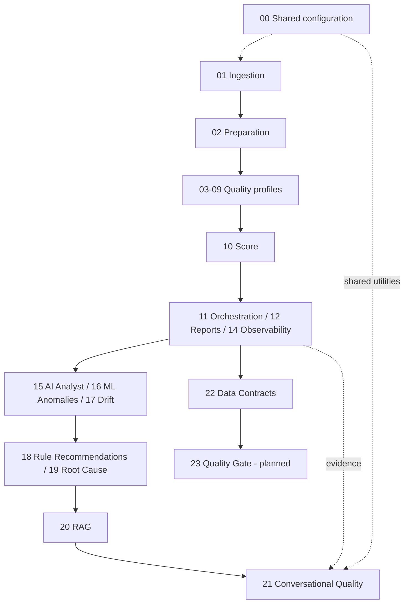

# Data Quality Framework | Engenharia de Dados, ML e LLM

Framework modular de qualidade de dados em Databricks e PySpark, com profiling, monitoramento, Machine Learning, RAG e análises opcionais assistidas por LLM.

[🇧🇷 Português](README.md) · [🇺🇸 English](README.en.md)

**Status:** notebooks desenvolvidos de forma incremental; execução integrada e prontidão para produção ainda não validadas. O módulo 13 foi adiado.

## Princípios de projeto

- **Evidência antes de conclusões:** anomalias estatísticas não são necessariamente erros de dados.
- **Independência de domínio:** sem regras fixas específicas da ANEEL ou de outro dataset.
- **Contratos explícitos:** critérios de aceitação exigem definição e aprovação humana.
- **LLM controlado:** desabilitado por padrão, fundamentado em evidências delimitadas, com auditabilidade e sem correção automática.
- **Processamento distribuído:** APIs de DataFrame Spark compatíveis com Databricks Unity Catalog.

## Arquitetura

## Catálogo de notebooks

| Nº | Notebook | Finalidade | Situação |
|---|---|---|---|
| `00` | `FRAMEWORK_CONFIG` | Configuração e funções compartilhadas | Em validação |
| `01` | `DATA_INGESTION` | Ingestão de dados | Em validação |
| `02` | `DATA_PREPARATION` | Preparação e padronização | Em validação |
| `03` | `SCHEMA_PROFILE` | Schema e completude | Em validação |
| `04` | `DISTRIBUTION_PROFILE` | Distribuições e concentração | Em validação |
| `05` | `PATTERN_PROFILE` | Padrões de valores | Em validação |
| `06` | `DUPLICITY_PROFILE` | Duplicidade e chaves candidatas | Em validação |
| `07` | `CONSISTENCY_PROFILE` | Consistência | Em validação |
| `08` | `OUTLIER_PROFILE` | Observações atípicas | Em validação |
| `09` | `CORRELATION_PROFILE` | Associações e correlações | Em validação |
| `10` | `DATA_QUALITY_SCORE` | Score explicável de qualidade | Em validação |
| `11` | `FRAMEWORK_ORCHESTRATOR` | Orquestração | Em validação |
| `12` | `DATA_QUALITY_REPORT` | Relatórios e indicadores | Em validação |
| `13` | `DATA_QUALITY_HISTORY` | Histórico (adiado) | Adiado |
| `14` | `DATA_QUALITY_OBSERVABILITY` | Observabilidade | Em validação |
| `15` | `AI_DATA_QUALITY_ANALYST` | Análise assistida por IA | Em validação |
| `16` | `ML_ANOMALY_DETECTION` | Detecção de anomalias por ML | Em validação |
| `17` | `DATA_QUALITY_DRIFT_DETECTION` | Detecção de drift | Em validação |
| `18` | `AI_RULE_RECOMMENDATION` | Sugestão de regras por IA | Em validação |
| `19` | `AI_ROOT_CAUSE_ANALYSIS` | Hipóteses de causa raiz | Em validação |
| `20` | `DATA_QUALITY_RAG` | Recuperação de conhecimento (RAG) | Em validação |
| `21` | `CONVERSATIONAL_DATA_QUALITY` | Consultas conversacionais com evidências | Em validação |
| `22` | `DATA_QUALITY_CONTRACTS` | Contratos e validação de regras | Em validação |

## O papel do LLM

O LLM é uma **camada opcional de interpretação e interação em linguagem natural**, não um substituto para as métricas determinísticas de qualidade. Os módulos 15, 18, 19, 20 e 21 exploram análise assistida, propostas de regras, hipóteses de causa raiz, recuperação de conhecimento e respostas conversacionais. As saídas devem ser confrontadas com as evidências; sugestões e hipóteses **não são fatos automaticamente aprovados**.

O módulo **21** consome resultados delimitados de relatórios, observabilidade, diagnósticos de IA, análise de causa raiz e RAG. Disponibiliza `dq_chat_sources_df`, `dq_chat_evidence_df`, `dq_chat_responses_df` e `dq_chat_audit_df`. O uso de LLM externo permanece desabilitado por padrão.

## Como executar

1. Importe os notebooks para um workspace Databricks.
2. Coloque a versão consolidada do `00_FRAMEWORK_CONFIG` na pasta compartilhada `bibliotecas`, respeitando os caminhos `%run` dos notebooks dependentes.
3. Configure a fonte de dados no módulo 01 e execute a preparação (02).
4. Execute os Profiles relevantes (03–09) e, conforme necessário, os módulos de relatório e análise.
5. Habilite recursos opcionais de LLM **somente após** configurar endpoint HTTPS autorizado e segredos. Não versione credenciais.

> A estrutura exata das pastas e os caminhos `%run` devem ser conferidos no workspace. Houve validações parciais de sintaxe, mas isso não representa validação integrada no Databricks.

## Base de demonstração

O projeto utilizou dados públicos de ocorrências emergenciais da ANEEL na exploração inicial. Essa é uma **base de exemplo**, não uma dependência do framework. O uso dos dados deve respeitar licenças e requisitos de privacidade da fonte.

## Roadmap

- [ ] Executar testes de integração ponta a ponta no Databricks Free Edition.
- [ ] Validar os contratos entre as saídas dos notebooks e seus consumidores.
- [ ] Implementar o módulo 23: Data Quality Gate.
- [ ] Evoluir lineage, avaliação de saídas de IA e interfaces de dashboard.
- [ ] Definir testes reproduzíveis e verificações de CI.

## Uso responsável

Não se presume um percentual universal de aceitação de qualidade. Limiares, políticas e aprovação de contratos cabem aos responsáveis pelos dados. Correções automáticas, persistência e chamadas a LLM externo devem ser explicitamente habilitadas e governadas.

## Contribuição

Issues e pull requests são bem-vindos. Inclua exemplos reproduzíveis, comportamento esperado e observações sobre compatibilidade com o runtime Databricks.
